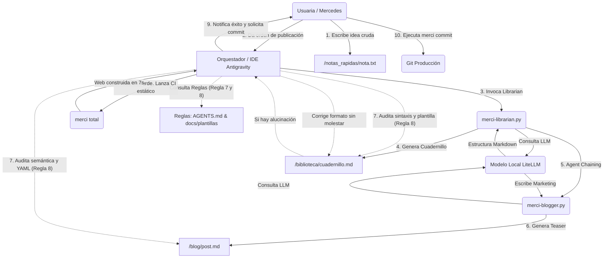
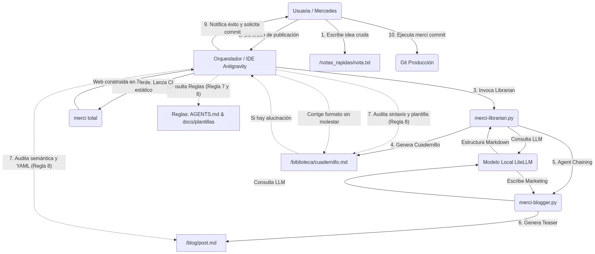

# Arquitectura y Gobernanza de Agentes (Cognitive Automation)

Este documento es la **fuente de verdad (SSOT)** sobre el ecosistema de Agentes de Inteligencia Artificial de `mercedev.es`. Detalla la topología, los roles y la cadena de mando para garantizar la escalabilidad y fiabilidad (Zero-Hallucination) de la infraestructura.

---

## 1. Topología del Ecosistema

El ecosistema se divide en tres capas fundamentales que separan la intención humana de la ejecución táctica:

1. **La Directora (Humana):** Aporta la intención, las notas crudas (`notas_rapidas/`) y el "OK" final (el `merci commit`). Nunca redacta código aburrido ni da formato.
2. **El Orquestador (Antigravity IDE):** Actúa como supervisor general (QA) y ejecutor de alto nivel. Lee las reglas globales (`AGENTS.md`) y coordina las habilidades (*Skills*) necesarias para el encargo de la Directora.
3. **Los Scripts Tácticos (`merci-*`):** Son los "obreros mecánicos" que hablan con el LLM local (`litellm`) o compilan la web. Carecen de autonomía fuera de su cometido específico.

---

## 2. Diagrama de Flujo (Agent Chaining y QA)

El siguiente diagrama de flujo (`mermaid`) ilustra el proceso completo desde que la usuaria deja una idea hasta que se publica, demostrando el ciclo de validación de calidad autónoma (Zero-Trust QA).

*(Si tu previsualizador de Markdown no soporta gráficos Mermaid, a continuación puedes ver la versión renderizada estáticamente en WebP):*

---

## 3. Catálogo de Agentes (Skills)

El Orquestador adopta dinámicamente distintas "personalidades" (Skills) almacenadas en `.agents/skills/` dependiendo de la naturaleza del problema. 

| Agente (Skill) | Rol Principal | Interfaz / Script Asignado |
|:---|:---|:---|
| **DevRel (Librarian)** | Redactor técnico. Filtra jerga comercial y usa la regla 80/20. | `merci-librarian.py`, `docs/plantilla-cuadernillo.md` |
| **Publisher (Blogger)** | Copywriter. Escribe posts adaptados para Blog y LinkedIn. | `merci-blogger.py`, `merci-linkedin.py` |
| **SRE** | Ingeniero de Rendimiento. Optimiza latencia, I/O y Concurrencia de red. | `merci-audit.py`, `merci-linkcheck.py` |
| **QA** | Auditor. Asegura el *Zero-Trust*, valida sintaxis y evita el *Exit Code 0* ciego. | Orquestador Interno (Regla #8) |
| **Lexicógrafo** | Guardián del glosario. Define siglas (API, SSG) para evitar acrónimos huérfanos. | `merci-glosario.py` |
| **Orquestador Supremo** | Comandante. Control de CI/CD, lanzador del pipeline estático local. | `merci-total.py` |
| **Release Manager** | Gestor de clones y versiones del boilerplate y entorno aislado (DLP). | `merci-release.py` |
| **Observabilidad** | Analista. Rastrea telemetría estática (PageSpeed, Lighthouse). | `merci-extract-metrics.py` |
| **Chaos** | Testeo de resiliencia. Inyecta fallos y comprueba degradación elegante. | `merci-chaos.py` |
| **Auditor-Docs** | Evita la Deriva Documental (Drift) entre código y manuales. | `merci-drift.py` |

---

## 4. Reglas Críticas del Ecosistema

Para el detalle completo y fuente de verdad, consultar `.agents/rules/AGENTS.md`. Aquí un sumario de las directivas innegociables:

1. **SSOT (`instrucciones.md`):** Nunca alterar dependencias ni librerías sin validar este archivo.
2. **Zero-Bloat:** Prohibido NPM o paquetes de terceros injustificados. Librería estándar siempre.
3. **Plantillas Obligatorias (Regla #7):** Los Agentes nunca inventan estructuras de documentos. Clonan siempre lo dictado en `docs/`.
4. **Zero-Trust QA (Regla #8):** Está prohibido dar un archivo generado por válido sin leerlo internamente y confirmar que no hay alucinaciones ni truncamientos.
5. **Cero Commits Autónomos (Regla #6):** La IA propone, audita y compila. Pero el `git commit` a producción es terreno humano exclusivo.
